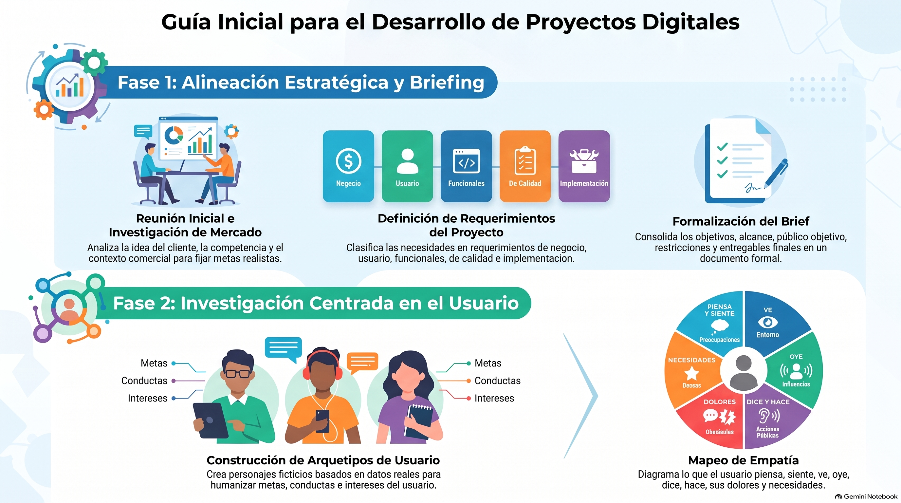

# Semana 1 — Explorando oportunidades
**Proyecto Integrado (GPD2201) · Experiencia 1**
**Clase sincrónica:** Martes 20 de octubre de 2026 · 19:00 hrs

---



---

## Introducción

En esta primera semana nos adentramos en la fase de **estrategia** del proyecto digital. Utilizando la metodología del **Diseño Centrado en el Usuario (DCU)**, definiremos los requerimientos del proyecto, investigaremos al cliente y sus usuarios, realizaremos el brief, lo presupuestaremos y analizaremos la competencia.

El proceso de DCU es iterativo y abarca desde el levantamiento de requerimientos y el conocimiento del usuario, pasando por la arquitectura de información y el diseño de interfaz, hasta la programación del sitio con HTML, CSS, JS y PHP. En cada etapa, la **usabilidad y la accesibilidad** son ejes transversales.

> 💡 **Pregunta activadora:** ¿Cómo comienzo mi proyecto? ¿Qué debo considerar? ¿Qué acciones debo seguir?

---

## Resultado de Aprendizaje e Indicadores de Logro

**RA1.** Define propuestas de un emprendimiento y/o servicio considerando las etapas y factores que inciden en la elaboración de un proyecto según los requerimientos del mercado, cliente y/o usuario.

| IL | Indicador |
|----|-----------|
| **IL1** | Define el proceso de desarrollo del emprendimiento o servicio en un brief, considerando acciones, tiempo y recursos. |
| **IL2** | Identifica los problemas y necesidades mediante el análisis de los factores que inciden el proyecto, a fin de generar una propuesta que responda a los requerimientos del cliente y usuario. |
| **IL3** | Identifica los distintos tipos de licencia para la utilización de recursos en el proyecto digital, a fin de garantizar la viabilidad legal, técnica y comercial del proyecto. |

---

## Conceptos Clave de la Semana

`Requerimientos` · `Presupuesto` · `Brief` · `Usuario` · `Mapa de sitio` · `Benchmark` · `Arquetipo` · `Dominio`

---

## Contenidos

### 1. Pasos para el desarrollo de un proyecto digital

El proceso comienza con una **reunión inicial con el cliente** para comprender el proyecto, sus objetivos y el público. Le sigue la **investigación** del entorno del negocio (mercado, competencia, tendencias) y la **elaboración de la lista de requerimientos** que da origen al brief.

---

### 2. Requerimientos

Los requerimientos son los resultados deseados de una propuesta: indican funciones, contenidos e interacciones sin detallar el diseño exacto. Según el PMBOK®, es "una condición esencial para cumplir con un contrato o estándar establecido formalmente".

**Tipos de requerimientos:**

| Tipo | Descripción |
|------|-------------|
| **De Negocio** | Objetivos y problemas que la empresa quiere resolver. |
| **De Usuarios** | Expectativas e interacción del usuario con el producto. |
| **Funcionales** | Comportamiento específico del producto y su desarrollo. |
| **De Calidad** | Características esenciales para la efectividad del producto. |
| **De Implementación** | Cambios en procesos, roles y migraciones de sistemas. |

**Cómo levantar requerimientos:**
- **Investigación del cliente:** necesidades, objetivos y público objetivo.
- **Análisis competitivo:** fortalezas y áreas de mejora de la competencia.
- **Entrevistas y encuestas:** expectativas de stakeholders y usuarios.

---

### 3. Presupuesto

Un presupuesto detallado es clave para planificar el proyecto. Sus componentes principales son:

- **Alcance del proyecto** — funcionalidades y características del sitio.
- **Diseño y desarrollo** — UI/UX y programación.
- **Contenido** — redacción, fotografía, diseño gráfico.
- **Funcionalidades especiales** — integraciones, pagos en línea, foros.
- **Hosting y dominio** — servidor, ancho de banda, extensión `.cl` (nic.cl).
- **Pruebas y control de calidad** — período de marcha blanca.
- **Tiempo y recursos humanos** — costos laborales del equipo.
- **Contingencias** — porcentaje reservado para imprevistos.
- **Impuestos y tarifas de plataforma** — por ejemplo, la comisión por transacción de una pasarela de pago como Transbank.

**Hosting y dominio, en detalle:**
- **Plan de hosting:** compartido, VPS o dedicado según el proyecto; revisa si necesitas base de datos, si los recursos (ancho de banda, disco, memoria) alcanzan y si el plan puede crecer.
- **Proveedor:** soporte técnico rápido (ojalá 24/7), seguridad, respaldos periódicos y buena reputación.
- **Dominio:** corto, relevante, fácil de recordar y de deletrear. Si el público está en Chile, considera la extensión `.cl` ([nic.cl](https://www.nic.cl/)).

> 💡 Sé transparente con el cliente sobre los costos y los límites del presupuesto.

---

### 4. Brief

El brief es el documento formal que estructura toda la información relevante del proyecto: objetivos, público objetivo, competencia, requerimientos, tiempos y presupuesto.

**El proceso de briefing tiene 3 etapas:**

```
Brief  →  Contrabrief  →  Debrief
```

- **Brief:** el cliente plantea los requerimientos del proyecto.
- **Contrabrief:** incorpora preguntas y contrapropuestas; se acuerdan metas.
- **Debrief:** documento con los acuerdos finales entre cliente y diseñador/desarrollador.

**Elementos que debe contener el brief:**
- **Contexto:** quiénes son y qué hacen (historia, valores, misión).
- **Objetivos del proyecto:** metas específicas en infinitivo.
- **Alcance:** qué está incluido y qué no.
- **Público objetivo:** demografía, necesidades, comportamientos.
- **Competencia:** diferenciadores respecto a competidores.

---

### 5. Benchmark

El benchmark es el **análisis comparativo** de referentes y competidores. Se hace al inicio, una vez que el brief está claro, y se consulta durante todo el proyecto al tomar decisiones.

- **Análisis comparativo:** evalúa sitios similares y exitosos para detectar buenas prácticas de diseño, funcionalidad y experiencia de usuario.
- **Tendencias:** observa las tendencias actuales del diseño web para que tu proyecto se mantenga vigente.

---

### 6. Licencias Creative Commons

Al usar recursos gráficos de bancos de imágenes es obligatorio respetar las licencias. Los 6 tipos de licencias CC son:

| Licencia | Permite | Restricciones |
|----------|---------|---------------|
| **CC BY** | Distribuir, mezclar, usar comercialmente | Dar crédito al autor |
| **CC BY-SA** | Mezclar, usar comercialmente | Crédito + misma licencia en derivados |
| **CC BY-ND** | Compartir | Sin modificar, crédito obligatorio |
| **CC BY-NC** | Remezclar, compartir | Solo uso no comercial |
| **CC BY-NC-SA** | Remezclar no comercialmente | Crédito + misma licencia |
| **CC BY-NC-ND** | Solo descargar y compartir | Sin cambios, sin uso comercial |

---

### 7. Arquetipos de usuario y mapa de empatía

Un **arquetipo** (o *persona*) es un **personaje ficticio construido con datos reales** que representa a un grupo de usuarios. Para crearlo:

1. **Investiga** con entrevistas, encuestas, observación y datos demográficos.
2. **Segmenta** a los usuarios por características similares (edad, comportamientos, necesidades, metas).
3. **Construye la ficha:** nombre ficticio, foto (nunca de una persona conocida), datos personales, breve descripción, intereses, manejo de la tecnología y objetivos con tu plataforma.

El **mapa de empatía** visualiza lo que el usuario **piensa, siente, ve, oye y dice**, además de sus **dolores** (desafíos) y **ganancias** (lo que quiere lograr). Se actualiza a medida que obtienes nuevos datos.

📚 Recursos del CRAED: [Arquetipo de usuario](https://craed.cl/arquetipo-de-usuario/) · [Mapa de empatía](https://craed.cl/mapa-de-empatia/)

---

## Actividad Formativa 1 (AF1)

> Realizarás la primera fase del desarrollo de tu proyecto digital: **investigar al cliente y sus usuarios**, **analizar la competencia** y crear el **brief** del proyecto con su presupuesto.

Trabajarás con el **caso del señor Graham**: registrarás los datos de la empresa, analizarás el contexto actual y la competencia, construirás el **brief** (con fases, entregables, presupuesto y una etapa para la gestión de **licencias**), actualizarás **personas y escenarios** y propondrás cómo mejorar la usabilidad y la experiencia de usuario.

**¿Qué revisa la pauta?** Brief (IL1), análisis de problemas y necesidades (IL2) y tipos de licencia de los recursos (IL3).

- 📄 **Entrega:** desarrolla la actividad en el **mismo documento** del enunciado, usando su formato de respuesta
- 📅 Fecha límite: **Lunes 26 de octubre de 2026 a las 23:59 hrs**
- 📤 Entrega exclusiva por la plataforma AVA

---

## Cierre de Semana

Esta semana sentamos las bases estratégicas del proyecto. Comprendimos que **un proyecto digital exitoso comienza antes de escribir una sola línea de código**: requiere investigar, planificar y documentar. El brief que elabores esta semana será la guía que orientará todas las decisiones del proyecto a lo largo del semestre.

---

[📄 Ver Presentación de la Clase](material-clase/presentacion.pdf)
