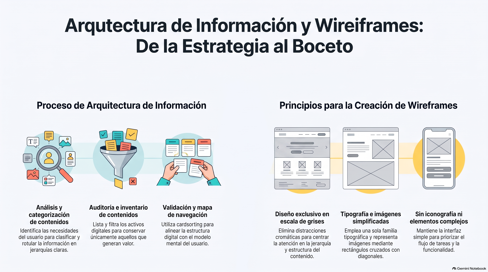

# Semana 2 — Creando Mapa de Navegación y Wireframes
**Proyecto Integrado (GPD2201) · Experiencia 1**
**Clase sincrónica:** Martes 27 de octubre de 2026 · 19:00 hrs

---



---

## Introducción

La **Arquitectura de la Información (AI)** es el proceso que garantiza que los contenidos de un sitio web sean localizables, comprensibles y fáciles de navegar. Cuanto más intuitiva, flexible, consistente y escalable sea, mejor será la **experiencia del usuario**.

Esta semana avanzamos dentro de la Experiencia 1: ya conocemos al cliente y al usuario (Semana 1), y ahora organizamos los contenidos del proyecto. Aprenderemos a construir el **mapa de navegación** del sitio y a elaborar los primeros **wireframes de baja resolución**.

> 💡 **Preguntas activadoras:** ¿Qué hago una vez que conozco al usuario? ¿Cómo organizo los contenidos? ¿Cómo los diagramo?

---

## Resultados de Aprendizaje e Indicadores de Logro

**RA1.** Define propuestas de un emprendimiento y/o servicio considerando las etapas y factores que inciden en la elaboración de un proyecto según los requerimientos del mercado, cliente y/o usuario.

| IL | Indicador |
|----|-----------|
| **IL1** | Define el proceso de desarrollo del emprendimiento o servicio en un brief, considerando acciones, tiempo y recursos. |
| **IL2** | Identifica los problemas y necesidades mediante el análisis de los factores que inciden el proyecto, a fin de generar una propuesta que responda a los requerimientos del cliente y usuario. |
| **IL3** | Identifica los distintos tipos de licencia para la utilización de recursos en el proyecto digital, a fin de garantizar la viabilidad legal, técnica y comercial del proyecto. |
| **IL4** | Arma mapa de navegación de sitio considerando los contenidos del proyecto. |
| **IL5** | Utiliza wireframes para la distribución jerárquica de los contenidos, considerando criterios de funcionalidad e interacción en coherencia con los objetivos del proyecto. |

---

## Conceptos Clave de la Semana

`Arquitectura de información` · `Inventario de contenidos` · `Categorías` · `Mapa de navegación` · `Cardsorting` · `Usabilidad` · `Rótulo` · `Wireframes`

---

## Contenidos

### 1. Arquitectura de Información y Usabilidad

La **arquitectura de la información** organiza el contenido para hacerlo localizable y comprensible, siempre con el usuario como foco. La **usabilidad** complementa esto: se refiere a la facilidad con que los usuarios pueden completar tareas de manera efectiva, eficiente y satisfactoria.

**Elementos que mejoran la usabilidad:**
- Colocar de forma obvia las acciones principales que los usuarios quieren realizar.
- Transparentar la información (sin ambigüedades).
- Reducir la cantidad de pasos necesarios.
- Generar información que resuelva las dudas del usuario.
- Anticiparse a las preguntas posibles con respuestas de fácil comprensión.

---

### 2. Los 10 Principios de Usabilidad de Jakob Nielsen

| # | Principio |
|---|-----------|
| 1 | Visibilidad del estado del sistema |
| 2 | Relación entre el sistema y el mundo real |
| 3 | Control y libertad del usuario |
| 4 | Consistencia y estándares |
| 5 | Prevención de errores |
| 6 | Reconocer antes que recordar |
| 7 | Flexibilidad y eficiencia de uso |
| 8 | Diseño estético y minimalista |
| 9 | Ayudar a reconocer, diagnosticar y corregir errores |
| 10 | Ayuda y documentación |

> 🔗 [Ver artículo completo en Nielsen Norman Group](https://www.nngroup.com/articles/ten-usability-heuristics/)

---

### 3. Proceso de Arquitectura de Información

El proceso AI tiene 5 pasos:

```
1. Analizar contexto del servicio/producto
        ↓
2. Identificar problemas que afectan al usuario
        ↓
3. Clasificar los problemas por temáticas y contenidos
        ↓
4. Establecer el problema principal y proponer solución
        ↓
5. Elaborar el inventario de contenidos
```

**El inventario de contenidos** lista todos los contenidos del sitio y registra:
- Número de identificación
- Rotulado o etiquetado
- Ubicación (URL)
- Descripción de la página (título, palabras clave)
- Tipo de contenido (landing page, blog, etc.)
- Tipo de activos (audio, video, documentos descargables)
- Comentarios

> Para construirlo se analizan los contenidos actuales, se realiza benchmark de la competencia, se proponen nuevos contenidos y se audita la calidad de cada uno.

---

### 4. Cardsorting

Técnica que permite validar el inventario de contenidos con usuarios reales. Se ponen a prueba las categorías propuestas para conocer el **mapa mental del usuario** y así crear una arquitectura de navegación coherente con cómo piensan y buscan información.

> 📌 *Los modelos mentales son representaciones internas que las personas construyen sobre cómo funciona el mundo, basadas en experiencias previas y aprendizajes. Los usuarios aplican estos modelos al interactuar con productos digitales.*

---

### 5. Mapa de Navegación

El mapa de navegación es el resultado final del proceso de AI. Muestra las **categorías jerarquizadas** que determinan cómo el usuario navega entre los contenidos del sitio.

**Para construirlo se integran:**
- Los objetivos del proyecto
- Las características y necesidades de los usuarios
- Los hallazgos del cardsorting
- Los sistemas de organización, etiquetado, navegación y búsqueda

Un mapa bien diseñado es la **base de la interfaz**: influye en cómo los usuarios encuentran la información y perciben la organización general del sitio.

---

### 6. Wireframes

Los wireframes son el **puente entre la arquitectura de información y el diseño de interfaz**: traducen el mapa de navegación en un esquema visual que muestra cómo se organizará el contenido en pantalla.

**Reglas esenciales al crear wireframes:**

| Regla | Detalle |
|-------|---------|
| 🎨 **Solo escala de grises** | Sin colores ni diseño gráfico; foco en estructura y jerarquía. |
| 🔤 **Una familia tipográfica** | Distintos tamaños y pesos para jerarquía visual, pero un solo tipo. |
| 🖼️ **Simular imágenes** | Rectángulos con diagonales o fondo gris; nunca imágenes reales. |
| 🚫 **Sin formas complejas** | Sin iconografía compleja; el foco es la funcionalidad y el espacio. |

> 🛠️ **Herramienta recomendada:** [Figma / FigJam](https://www.figma.com/figjam/) — permite tener el mapa de sitio, flujos y wireframe en un solo lugar.

---

## Actividad Sumativa 1 (AS1) — Creando un wireframe del proyecto

> Realizarás el **mapa de navegación** de tu sitio y un **wireframe de baja resolución** aplicando el proceso completo de arquitectura de información: inventariar los contenidos, diagramarlos en el mapa y crear la primera aproximación gráfica.

1. **Inventario de contenidos:** lista todos los contenidos (textos, imágenes, videos…) y agrúpalos por categorías.
2. **Mapa del sitio:** a partir del inventario, muestra la estructura y la relación entre secciones, con una jerarquía clara (en digital o en papel).
3. **Wireframe de baja resolución:** ubica encabezado, contenido principal, barra lateral y elementos de navegación (menús, botones, enlaces), en coherencia con el mapa.

**¿Qué evalúa la rúbrica?** Cinco criterios de 20 puntos cada uno: **brief** (IL1), **problemas y necesidades** (IL2), **licencias** (IL3), **mapa de navegación** (IL4) y **wireframes** (IL5). Incluye tu brief actualizado en la entrega.

- 📁 **Entrega:** guarda todos los documentos y esquemas en **una carpeta** y comprímela en un archivo **.zip**
- 📝 Si hiciste mejoras durante el diseño, documéntalas en un **informe** y agrégalo a la entrega
- 📅 Fecha límite: **Lunes 2 de noviembre de 2026 a las 23:59 hrs**
- 📤 Entrega exclusiva por la plataforma AVA

---

## Cierre de Semana

Esta semana completamos la Experiencia 1. Organizamos los contenidos con criterio: conociendo al usuario, aplicando los principios de usabilidad de Nielsen y estructurando la información de forma jerárquica. El mapa de navegación y los wireframes son las herramientas que garantizan que nuestras decisiones de diseño estén fundamentadas en las necesidades reales del usuario.

---

[📄 Ver Presentación de la Clase](material-clase/presentacion.pdf)
