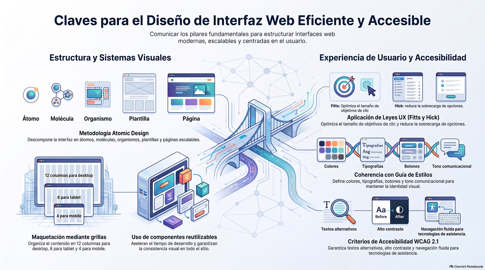

# Semana 3 — Diseñando la Interfaz del Sitio
**Proyecto Integrado (GPD2201) · Experiencia 2**
**Clase sincrónica:** Martes 3 de noviembre de 2026 · 19:00 hrs

---



---

## Introducción

Esta semana iniciamos la **Experiencia 2: Diseñando y desarrollando nuestra propuesta**. La interfaz de un sitio web actúa como el punto de interacción entre los usuarios y el contenido; su calidad impacta directamente en la experiencia del usuario y en el éxito del proyecto.

Partiendo desde el wireframe de baja resolución construido en la Semana 2, avanzamos al **wireframe de alta resolución** y al **diseño visual completo**, incorporando colores, tipografías, componentes y la **guía de estilos** que garantizará la coherencia visual en todo el proyecto.

> 💡 **Preguntas activadoras:** ¿Qué debe tener mi guía de estilos? ¿Cómo organizo la inspiración para mi sitio? ¿Qué debo considerar para la interacción?

---

## Resultados de Aprendizaje e Indicadores de Logro

**RA1.** Define propuestas de un emprendimiento y/o servicio considerando las etapas y factores que inciden en la elaboración de un proyecto según los requerimientos del mercado, cliente y/o usuario.

**RA2.** Aplica técnicas de distribución de contenidos en pantalla considerando la jerarquía de información, a fin de conectar la arquitectura de la información con el diseño de interfaz.

| IL | Indicador |
|----|-----------|
| **IL1** | Define el proceso de desarrollo del emprendimiento o servicio en un brief, considerando acciones, tiempo y recursos. |
| **IL2** | Identifica los problemas y necesidades mediante el análisis de los factores que inciden el proyecto, a fin de generar una propuesta que responda a los requerimientos del cliente y usuario. |
| **IL4** | Arma mapa de navegación de sitio considerando los contenidos del proyecto. |
| **IL5** | Utiliza wireframes para la distribución jerárquica de los contenidos, considerando criterios de funcionalidad e interacción en coherencia con los objetivos del proyecto. |
| **IL6** | Arma diseño de interfaz interactiva, considerando la guía de estilos definida. |

---

## Conceptos Clave de la Semana

`Diseño de interfaz` · `Moodboard` · `Accesibilidad` · `Interacción` · `Componentes` · `Atomic Design` · `Ley de Hick` · `Ley de Fitts` · `Grillas`

---

## Contenidos

### 1. Del Wireframe de Baja al de Alta Resolución

**Wireframe de alta fidelidad:** representa un paso más detallado que el de baja resolución. Muestra cómo funcionará y se visualizará la interfaz con mayor precisión, siendo la base para los **mockups finales**. En esta etapa ya trabajamos con el contenido real y los detalles funcionales, pero los cambios aún son rápidos de implementar.

```
Wireframe baja → Wireframe alta → Mockup visual → Prototipo interactivo
```

---

### 2. Moodboard: La Inspiración

El moodboard es un **collage visual de referencias** que define el estilo y la atmósfera del proyecto antes de comenzar el diseño. Reúne:

- Paletas de colores de referencia
- Estilos tipográficos
- Fotografías e ilustraciones de inspiración
- Patrones de diseño y UI que guiarán el proyecto

---

### 3. Creando el Diseño de Interfaz

#### Guía de Estilos

La guía de estilos es el documento que establece las **pautas y normativas visuales** del proyecto para garantizar coherencia en todos los elementos:

| Elemento | Descripción |
|----------|-------------|
| **Tipografía** | Familias, tamaños, pesos y jerarquías tipográficas. |
| **Paleta de colores** | Colores primarios, secundarios, neutros y de acento. |
| **Iconografía** | Estilo y biblioteca de íconos a usar. |
| **Componentes** | Botones, formularios, tarjetas, navegación (estados: normal, hover, activo). |
| **Espaciado** | Márgenes, paddings y espaciado entre elementos. |
| **Efectos** | Sombras, bordes, animaciones y transiciones. |

#### Interacción

Dos leyes fundamentales de diseño de interacción:

| Ley | Aplicación práctica |
|-----|---------------------|
| **Ley de Hick** | A mayor cantidad de opciones, mayor tiempo de decisión del usuario. → Simplificar y agrupar las opciones. |
| **Ley de Fitts** | Los elementos más usados deben ser más grandes y estar más cerca del cursor. → Tamaño y posición estratégica de los botones CTA. |

---

### 4. Grilla

La grilla es el **sistema de columnas** que estructura la distribución espacial del contenido en pantalla. Garantiza alineación, jerarquía visual y coherencia entre páginas.

- Sistema estándar: **12 columnas** (compatible con Bootstrap)
- Define márgenes exteriores y canaletas (gutters) entre columnas
- Facilita la adaptación a diferentes tamaños de pantalla (responsive)

---

### 5. Sistema de Diseño — Atomic Design

El **Atomic Design** propone construir interfaces a partir de componentes mínimos que se combinan progresivamente:

```
Átomos → Moléculas → Organismos → Plantillas → Páginas
```

- **Átomos:** elementos básicos (botones, inputs, etiquetas).
- **Moléculas:** grupos de átomos (formulario = label + input + botón).
- **Organismos:** secciones completas (header, tarjeta de producto).
- **Plantillas:** disposición de organismos sin contenido real.
- **Páginas:** plantillas con contenido real y final.

---

### 6. Responsive Design

El diseño de interfaz debe contemplar desde el inicio cómo se verá el sitio en **diferentes dispositivos**. Las decisiones de grilla, tamaño de tipografía, espaciado y disposición de elementos deben adaptarse a:
- 📱 Móvil (hasta 576px)
- 📲 Tablet (576px – 992px)
- 🖥️ Escritorio (992px en adelante)

---

### 7. Accesibilidad en el Diseño de Interfaz

El diseño accesible garantiza que el sitio sea usable por **todas las personas**, incluyendo aquellas con discapacidades visuales, auditivas o motoras. Criterios a considerar en diseño:

- **Contraste de colores:** mínimo 4.5:1 entre texto y fondo (WCAG AA).
- **Tamaño de tipografía:** mínimo 16px para texto de cuerpo.
- **Indicadores de foco:** visibles para navegación con teclado.
- **Alternativas textuales** para contenido visual.
- **No dependencia del color** como único indicador de información.

---

## Actividad Formativa 3 (AF3)

> Crearás el **wireframe de alta resolución** de tu proyecto, agregando detalles visuales (colores, tipografías) para transformar el esquema básico en una representación cercana a la interfaz final. Además, definirás y aplicarás la **guía de estilos** del proyecto.

- 📁 Archivo ZIP · Nomenclatura: `PInt_S3_NombreApellido.zip`
- 📅 Fecha límite: **Lunes 9 de noviembre de 2026 a las 23:59 hrs**
- 📤 Entrega exclusiva por la plataforma AVA

---

## Cierre de Semana

Esta semana dimos el salto del esquema funcional al diseño visual. La guía de estilos, el moodboard y los principios de interacción son herramientas que aseguran que la interfaz no solo sea estética, sino también funcional, accesible y coherente. El diseño que creamos esta semana será la base exacta sobre la que codificaremos el sitio en las próximas semanas.

---

[📄 Ver Presentación de la Clase](material-clase/presentacion.pdf)
