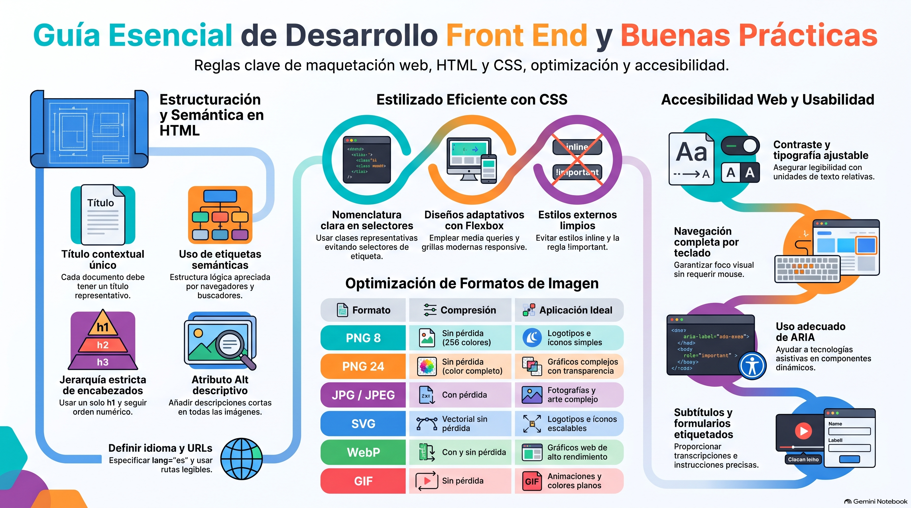

# Semana 4 — Maqueteando el Sitio del Proyecto
**Proyecto Integrado (GPD2201) · Experiencia 2**
**Clase sincrónica:** Martes 10 de noviembre de 2026 · 19:00 hrs

---

---

## Introducción

Esta semana pasamos del diseño al **desarrollo Front-End**: es el momento de abrir el editor de código. Detrás de cada elemento de la interfaz que diseñaste en Figma hay una estructura en **HTML** y unos estilos en **CSS** que le dan forma.

Con la interfaz, las interacciones y la guía de estilos ya definidas, ahora traduces ese diseño a código usando **Bootstrap** como framework de CSS, sin olvidar la **optimización de imágenes** y la **accesibilidad**.

> 💡 **Preguntas activadoras:** ¿Qué prácticas debo aplicar para estructurar y estilar un sitio web? ¿Cómo optimizo las imágenes? ¿Cómo aplico la accesibilidad cuando escribo código?

---

## Resultados de Aprendizaje e Indicadores de Logro

**RA1.** Define propuestas de un emprendimiento y/o servicio considerando las etapas y factores que inciden en la elaboración de un proyecto según los requerimientos del mercado, cliente y/o usuario.

**RA2.** Aplica técnicas de distribución de contenidos en pantalla considerando la jerarquía de información, a fin de conectar la arquitectura de la información con el diseño de interfaz.

| IL | Indicador |
|----|-----------|
| **IL1** | Define el proceso de desarrollo del emprendimiento o servicio en un brief, considerando acciones, tiempo y recursos. |
| **IL2** | Identifica los problemas y necesidades mediante el análisis de los factores que inciden el proyecto, a fin de generar una propuesta que responda a los requerimientos del cliente y usuario. |
| **IL4** | Arma mapa de navegación de sitio considerando los contenidos del proyecto. |
| **IL5** | Utiliza wireframes para la distribución jerárquica de los contenidos, considerando criterios de funcionalidad e interacción en coherencia con los objetivos del proyecto. |
| **IL6** | Arma diseño de interfaz interactiva, considerando la guía de estilos definida. |
| **IL7** | Construye archivos HTML considerando la nomenclatura y estructura de documento según estándar W3C. |
| **IL8** | Utiliza frameworks, variables nativas de CSS y preprocesadores, para optimizar el desarrollo de un sitio web. |

---

## Conceptos Clave de la Semana

`Front-End` · `HTML` · `CSS` · `Framework CSS` · `Accesibilidad` · `ARIA`

---

## Contenidos

### 1. ¿Qué es el desarrollo Front-End?

Es la construcción de la parte del sitio que la persona **ve y usa directamente**: la interfaz. Se trabaja con **HTML** (estructura), **CSS** (presentación) y **JavaScript** (comportamiento). El Front-End trabaja en equipo con el diseño UI y con el desarrollo Back-End.

---

### 2. HTML: buenas prácticas

| Práctica | Qué significa |
|----------|---------------|
| **`<title>` contextual** | Cada página tiene un título que describe su contenido. |
| **Etiquetas semánticas** | `header`, `nav`, `main`, `section`, `article`, `figure`, `figcaption`, `footer` ordenan la información para buscadores y lectores de pantalla. |
| **Un solo `<h1>`** | Un `h1` por página y encabezados en orden: después de `h1` viene `h2`, nunca un salto a `h3`. |
| **Idioma declarado** | `<html lang="es">` en un sitio en español. |
| **`alt` en imágenes** | Texto breve que describe la imagen; ayuda a la accesibilidad y al SEO. |
| **URLs amigables** | Nombres cortos y claros que reflejan la estructura del sitio. |
| **Validación** | Revisa tu código en el [W3C Validator](https://validator.w3.org/): por URL, subiendo el archivo o pegando el código. |

---

### 3. CSS: buenas prácticas

- Usa **clases** en vez de selectores de etiqueta, para no afectar otros elementos sin querer.
- Pon **nombres consistentes** a clases e IDs, que expliquen su función.
- Deja los estilos en un **archivo `.css` externo**: evita `style=""` y bloques `<style>`.
- Usa **media queries** para adaptar el diseño a distintas pantallas.
- Agrega **prefijos de navegador** cuando una propiedad nueva lo necesite.
- Arma los layouts con **Flexbox** y **Grid**.
- Escribe **comentarios** que expliquen las secciones clave.
- Evita `!important`: complica el mantenimiento.

---

### 4. Optimización de imágenes

Comprimir y elegir bien el formato mejora la velocidad de carga.

| Formato | Compresión | Úsalo para |
|---------|-----------|------------|
| **PNG-8** | Sin pérdida, 256 colores | Logos e íconos simples |
| **PNG-24** | Sin pérdida, color completo | Imágenes con transparencia y mucho detalle |
| **JPG** | Con pérdida | Fotografías |
| **SVG** | Vectorial, muy liviano | Logos, íconos y gráficos que escalan |
| **WebP** | Con o sin pérdida | Opción eficiente para la web (equilibrio calidad/peso) |
| **GIF** | Sin pérdida | Colores planos y animaciones simples |

> 🛠️ **Herramienta:** [TinyPNG](https://tinypng.com/) reduce el peso de tus imágenes sin bajar la calidad visible.

---

### 5. Frameworks y bibliotecas

Un **framework** (como **Bootstrap**) es código ya escrito que acelera el desarrollo: grilla, componentes y utilidades listas. Una **biblioteca** es una colección de funciones para tareas puntuales; en CSS abundan las de **animaciones** (por ejemplo, [Animate.css](https://animate.style/) o [Animista](https://animista.net/)).

---

### 6. Accesibilidad en el código

- **HTML semántico**, para que los lectores de pantalla entiendan la estructura.
- **Texto `alt`** en las imágenes que comunican información.
- **Contraste suficiente** entre texto y fondo.
- **Navegación con teclado** y un **foco visible** en los elementos activos.
- **Texto ampliable**: evita fijar tamaños de fuente en píxeles.
- **Pruebas** en varios navegadores y dispositivos.
- **Subtítulos y transcripciones** para videos y audios.
- **Atributos ARIA**, usados según las pautas, para componentes dinámicos.
- **Formularios accesibles**: cada campo con su etiqueta y mensajes de error claros.

---

## Actividad Formativa 3 (AF3) — Estilando el sitio del proyecto

> Traducirás tu diseño de interfaz a **HTML y CSS**, usando las clases de **Bootstrap** (grilla, componentes y variables) y personalizándolas según tu guía de estilos. Luego probarás el sitio en distintos dispositivos y navegadores, y ajustarás lo necesario para mejorar la experiencia y la accesibilidad.

**¿Qué revisa la pauta?** Brief, problemas y necesidades, mapa de navegación, wireframes, diseño de interfaz, HTML según W3C, uso de frameworks/variables CSS/preprocesadores y sitio responsivo. Mantén tu brief y tu mapa actualizados.

- 🔗 **Entrega:** sube tu sitio al **hosting de Duoc**, copia la **URL** y pégala en el documento de la actividad
- 📅 Fecha límite: **Lunes 16 de noviembre de 2026 a las 23:59 hrs**
- 📤 Entrega exclusiva por la plataforma AVA

---

## Cierre de Semana

Esta semana tradujiste tu diseño de interfaz a un sitio web funcional y accesible: **HTML para la estructura**, **CSS para el estilo** y **Bootstrap** para avanzar más rápido. El código limpio y semántico que escribas ahora es la base sobre la que harás el sitio responsivo en la Semana 5 y le agregarás PHP en la Semana 6.

---

[📄 Ver Presentación de la Clase](material-clase/presentacion.pdf)
