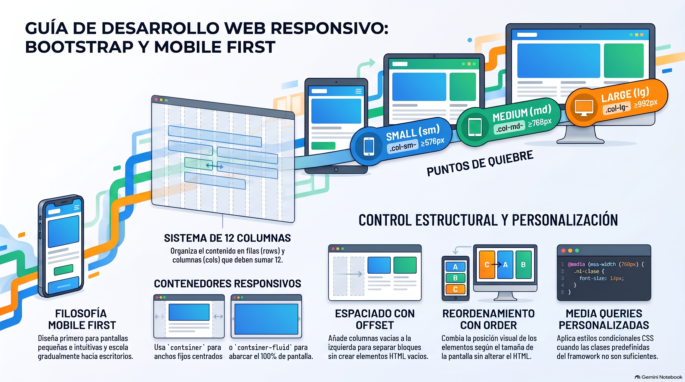

# Semana 5 — Diseño Responsivo en Acción
**Proyecto Integrado (GPD2201) · Experiencia 2**
**Clase sincrónica:** Martes 17 de noviembre de 2026 · 19:00 hrs

---



---

## Introducción

Hoy la mayoría de las personas visita los sitios desde el celular. Esta semana adaptas el sitio que maquetaste en la Semana 4 para que funcione en **teléfonos, tablets y computadores de escritorio**, con un enfoque **Mobile First**, la **grilla de Bootstrap**, **Sass** y tus propias **media queries**.

Es la **Actividad Sumativa 2**, con la que cerramos la Experiencia 2.

> 💡 **Preguntas activadoras:** ¿Sabías que basta una clase para que un elemento se adapte en el celular? ¿Cómo combino clases para que se vea distinto según el dispositivo? ¿Cómo trabajan juntos Mobile First, la grilla y las media queries?

---

## Resultados de Aprendizaje e Indicadores de Logro

**RA1.** Define propuestas de un emprendimiento y/o servicio considerando las etapas y factores que inciden en la elaboración de un proyecto según los requerimientos del mercado, cliente y/o usuario.

**RA2.** Aplica técnicas de distribución de contenidos en pantalla considerando la jerarquía de información, a fin de conectar la arquitectura de la información con el diseño de interfaz.

**RA3.** Crea sitio web utilizando framework y preprocesadores para optimizar el desarrollo de sitios web responsivos.

| IL | Indicador |
|----|-----------|
| **IL1** | Define el proceso de desarrollo del emprendimiento o servicio en un brief, considerando acciones, tiempo y recursos. |
| **IL2** | Identifica los problemas y necesidades mediante el análisis de los factores que inciden el proyecto, a fin de generar una propuesta que responda a los requerimientos del cliente y usuario. |
| **IL4** | Arma mapa de navegación de sitio considerando los contenidos del proyecto. |
| **IL5** | Utiliza wireframes para la distribución jerárquica de los contenidos, considerando criterios de funcionalidad e interacción en coherencia con los objetivos del proyecto. |
| **IL6** | Arma diseño de interfaz interactiva, considerando la guía de estilos definida. |
| **IL7** | Construye archivos HTML considerando la nomenclatura y estructura de documento según estándar W3C. |
| **IL8** | Utiliza frameworks, variables nativas de CSS y preprocesadores, para optimizar el desarrollo de un sitio web. |
| **IL9** | Desarrolla un sitio web responsivo, considerando los requerimientos visuales y técnicos del proyecto. |

---

## Conceptos Clave de la Semana

`Mobile First` · `Grilla` · `CSS` · `Media query` · `Framework CSS` · `Componentes`

---

## Contenidos

### 1. Mobile First

Es diseñar y programar **primero para la pantalla pequeña** y después escalar hacia pantallas más grandes. Una pantalla chica obliga a priorizar: interfaz simple, contenido esencial y navegación clara. Bootstrap ya trabaja así.

---

### 2. Breakpoints de Bootstrap

| Breakpoint | Prefijo de clase | Ancho de pantalla |
|------------|------------------|-------------------|
| Extra small | *(sin prefijo)* | < 576 px |
| Small | `sm` | ≥ 576 px |
| Medium | `md` | ≥ 768 px |
| Large | `lg` | ≥ 992 px |
| Extra large | `xl` | ≥ 1200 px |
| Extra extra large | `xxl` | ≥ 1400 px |

Una clase con prefijo se aplica **desde ese ancho hacia arriba**. Por ejemplo, `col-md-6` ocupa la mitad del ancho desde 768 px.

---

### 3. La grilla de Bootstrap

- Se divide en **12 columnas**.
- La estructura siempre es **`container` → `row` → `col`**.
- **`container`** centra el contenido con un ancho máximo según la pantalla; **`container-fluid`** ocupa todo el ancho.
- Las columnas de una fila suman 12 para llenar el ancho.
- Puedes **combinar clases** para cambiar el diseño por dispositivo, por ejemplo `col-12 col-md-6 col-lg-4`.

```html
<div class="container">
  <div class="row">
    <div class="col-12 col-md-6">Columna A</div>
    <div class="col-12 col-md-6">Columna B</div>
  </div>
</div>
```

---

### 4. Nesting, offset y order

| Técnica | Para qué sirve | Ejemplo |
|---------|----------------|---------|
| **Nesting** (anidamiento) | Poner una nueva `row` con columnas dentro de una columna, para layouts más detallados. | `<div class="col-sm-3"><div class="row">…</div></div>` |
| **Offset** | Dejar un espacio vacío del ancho de una o más columnas, sin crear columnas vacías. | `col-md-4 offset-md-4` |
| **Order** | Cambiar el orden visual de las columnas según el breakpoint. | `order-md-2` / `order-md-1` |

---

### 5. Sass

**Sass** es un preprocesador de CSS: permite **variables**, **mixins** y anidamiento, y luego se compila a CSS. Con Sass puedes personalizar Bootstrap (colores, tipografías, grilla, utilities); por ejemplo, cambiar el color primario de todo el sitio sobrescribiendo una variable antes de compilar. Revisa siempre la **versión de Bootstrap** con la que trabajas. 📚 [Personalizar Bootstrap con Sass](https://getbootstrap.com/docs/5.3/customize/sass/)

---

### 6. Media queries propias

Cuando las clases del framework no alcanzan, creas tus propias media queries en **tu hoja de estilos**, enlazada **después** de la de Bootstrap.

```css
/* @media tipo-de-dispositivo and (condición) { estilos } */
@media screen and (min-width: 768px) {
  .hero__titulo { font-size: 3rem; }
}
```

- **`@media`** inicia la regla.
- **Tipo de dispositivo:** `screen`, `print`, `speech`…
- **Condición:** ancho, alto, resolución u orientación.
- **`{ }`:** los estilos que se aplican solo si se cumple la condición.

---

### 7. Recomendaciones al usar un framework

- Aprovecha los **componentes nativos**: navbar, cards, modals y formularios.
- Usa las **utilities** (color, espaciado, alineación, sombras) y los **helpers** (`ratio` para videos responsivos, `position`, `visibility`).
- Bootstrap 5 usa **JavaScript nativo**: no necesita jQuery.
- Consulta la **documentación oficial** de tu versión.
- Prueba en **distintos navegadores y dispositivos**, con el inspector o en equipos reales.

---

## Actividad Sumativa 2 (AS2) — Aplicando el diseño responsivo al proyecto

> Mejorarás el sitio de la Semana 4 para que sea **responsivo**: revisarás cómo se ve en el celular, definirás con Mobile First cómo se reorganiza cada sección, aplicarás las clases responsivas de Bootstrap y tus media queries, cuidarás el peso de imágenes y videos, y mejorarás el rendimiento y la legibilidad del código.

**¿Qué evalúa la rúbrica?** Ocho criterios: **brief**, **problemas y necesidades**, **mapa de navegación**, **wireframes**, **diseño de interfaz**, **HTML según W3C**, **frameworks, variables CSS y preprocesadores** y **sitio responsivo**. No se evalúa solo lo técnico: tu brief, tu mapa y tus wireframes también deben estar actualizados y ser coherentes con el sitio.

- 🔗 **Entrega:** sube tu sitio al **hosting de Duoc**, copia la **URL** y pégala en el documento de la actividad
- 📝 Si hiciste mejoras durante el proceso, documéntalas en un **informe** y entrégalo junto con la actividad
- 📅 Fecha límite: **Lunes 23 de noviembre de 2026 a las 23:59 hrs**
- 📤 Entrega exclusiva por la plataforma AVA

---

## Cierre de Semana

El diseño responsivo es hoy un estándar: asegura que el sitio sea accesible, atractivo y funcional en cualquier dispositivo. Con un framework como Bootstrap, el trabajo se reduce a entender y combinar bien sus clases, y a completar con tus propias media queries. Prueba tu sitio de forma continua en distintos tamaños de pantalla.

---

[📄 Ver Presentación de la Clase](material-clase/presentacion.pdf)
