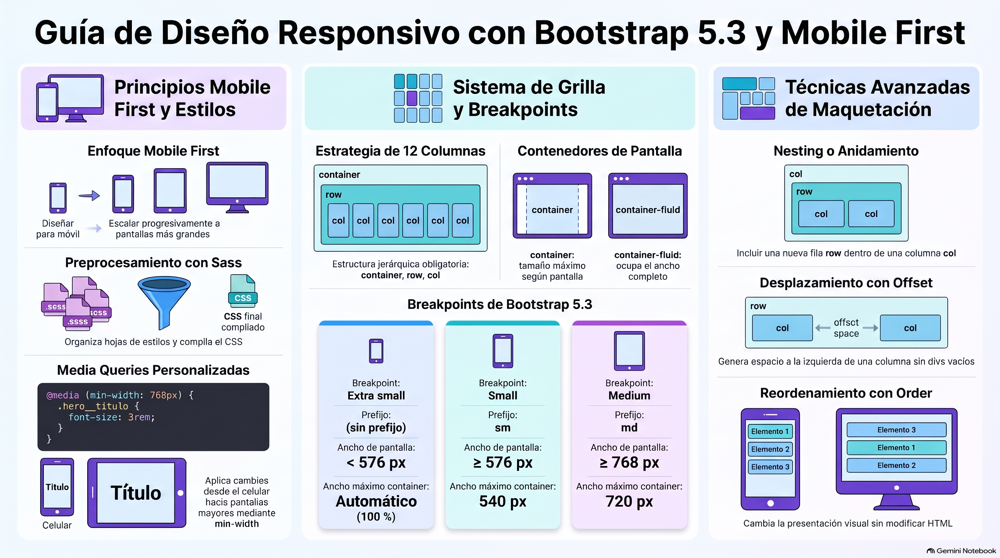

# Semana 5 — Diseño Responsivo en Acción
**Proyecto Integrado (GPD2201) · Experiencia 2**
**Clase sincrónica:** Martes 17 de noviembre de 2026 · 19:00 hrs

---



---

> ⚠️ **¿Qué versión de Bootstrap usamos?** En este curso trabajamos con **Bootstrap 5.3** (versión estable; la última es la **5.3.9**, del 11 de noviembre de 2026).
> Desde octubre de 2026 existe **Bootstrap 6 Alpha**, una versión de **prueba** que todavía no está lista para sitios reales. El problema: **la portada de [getbootstrap.com](https://getbootstrap.com) ahora abre la documentación de la v6 alpha**, y muchas clases se escriben distinto.
> 👉 Entra siempre a la documentación de tu versión: **[getbootstrap.com/docs/5.3](https://getbootstrap.com/docs/5.3/)**. Al final de este resumen tienes una tabla con las diferencias.

---

## Introducción

Hoy la mayoría de las personas visita los sitios desde el celular. Esta semana adaptas el sitio que maquetaste en la Semana 4 para que funcione en **teléfonos, tablets y computadores de escritorio**, con un enfoque **Mobile First**, la **grilla de Bootstrap**, **Sass** y tus propias **media queries**.

Es la **Actividad Sumativa 2**, con la que cerramos la Experiencia 2.

> 💡 **Preguntas activadoras:** ¿Sabías que basta una clase para que un elemento se adapte en el celular? ¿Cómo combino clases para que se vea distinto según el dispositivo? ¿Cómo trabajan juntos Mobile First, la grilla y las media queries?

---

## Resultados de Aprendizaje e Indicadores de Logro

**RA1.** Define propuestas de un emprendimiento y/o servicio considerando las etapas y factores que inciden en la elaboración de un proyecto según los requerimientos del mercado, cliente y/o usuario.

**RA2.** Aplica técnicas de distribución de contenidos en pantalla considerando la jerarquía de información, a fin de conectar la arquitectura de la información con el diseño de interfaz.

**RA3.** Crea sitio web utilizando framework y preprocesadores para optimizar el desarrollo de sitios web responsivos.

| IL | Indicador |
|----|-----------|
| **IL1** | Define el proceso de desarrollo del emprendimiento o servicio en un brief, considerando acciones, tiempo y recursos. |
| **IL2** | Identifica los problemas y necesidades mediante el análisis de los factores que inciden el proyecto, a fin de generar una propuesta que responda a los requerimientos del cliente y usuario. |
| **IL4** | Arma mapa de navegación de sitio considerando los contenidos del proyecto. |
| **IL5** | Utiliza wireframes para la distribución jerárquica de los contenidos, considerando criterios de funcionalidad e interacción en coherencia con los objetivos del proyecto. |
| **IL6** | Arma diseño de interfaz interactiva, considerando la guía de estilos definida. |
| **IL7** | Construye archivos HTML considerando la nomenclatura y estructura de documento según estándar W3C. |
| **IL8** | Utiliza frameworks, variables nativas de CSS y preprocesadores, para optimizar el desarrollo de un sitio web. |
| **IL9** | Desarrolla un sitio web responsivo, considerando los requerimientos visuales y técnicos del proyecto. |

---

## Conceptos Clave de la Semana

`Mobile First` · `Grilla` · `CSS` · `Media query` · `Framework CSS` · `Componentes`

---

## Contenidos

### 1. Mobile First

Es diseñar y programar **primero para la pantalla pequeña** y después escalar hacia pantallas más grandes. Una pantalla chica obliga a priorizar: interfaz simple, contenido esencial y navegación clara. Bootstrap ya trabaja así: **lo que escribes sin prefijo es para el celular**, y las clases con prefijo agregan cambios para pantallas más grandes.

Antes de cualquier cosa, tu `<head>` debe tener la etiqueta viewport; sin ella el celular muestra el sitio "achicado" y nada de lo responsivo funciona:

```html
<meta name="viewport" content="width=device-width, initial-scale=1">
```

---

### 2. Breakpoints de Bootstrap 5.3

Bootstrap tiene **6 breakpoints** (puntos de quiebre):

| Breakpoint | Prefijo de clase | Ancho de pantalla | Ancho máximo del `container` |
|------------|------------------|-------------------|------------------------------|
| Extra small | *(sin prefijo)* | < 576 px | Automático (100 %) |
| Small | `sm` | ≥ 576 px | 540 px |
| Medium | `md` | ≥ 768 px | 720 px |
| Large | `lg` | ≥ 992 px | 960 px |
| Extra large | `xl` | ≥ 1200 px | 1140 px |
| Extra extra large | `xxl` | ≥ 1400 px | 1320 px |

- La grilla tiene **12 columnas** y un **gutter** (espacio entre columnas) de **1,5 rem** (0,75 rem a cada lado).
- Una clase con prefijo se aplica **desde ese ancho hacia arriba**. Por ejemplo, `col-md-6` ocupa la mitad del ancho desde 768 px.

📚 [Breakpoints · Bootstrap 5.3](https://getbootstrap.com/docs/5.3/layout/breakpoints/)

---

### 3. La grilla de Bootstrap

- Se divide en **12 columnas**.
- La estructura siempre es **`container` → `row` → `col`**.
- **`container`** centra el contenido con un ancho máximo según la pantalla (tabla anterior); **`container-fluid`** ocupa todo el ancho de la ventana, sin márgenes laterales.
- Las columnas de una fila suman 12 para llenar el ancho.
- Puedes **combinar clases** para cambiar el diseño por dispositivo, por ejemplo `col-12 col-md-6 col-lg-4`.

```html
<div class="container">
  <div class="row">
    <div class="col-12 col-md-6">Columna A</div>
    <div class="col-12 col-md-6">Columna B</div>
  </div>
</div>
```

**Cómo "hereda" la grilla (Mobile First):** cada clase vale para su breakpoint **y todos los más grandes**, hasta que otra clase la reemplace.

| Clases | Celular (< 576) | Small (≥ 576) | Tablet (≥ 768) | Escritorio (≥ 992) |
|--------|-----------------|---------------|----------------|--------------------|
| `col-md-6` | 100 % | 100 % | 50 % | 50 % |
| `col-12 col-sm-6 col-lg-4` | 100 % | 50 % | 50 % | 33 % |
| `col-4` | 33 % ⚠️ | 33 % | 33 % | 33 % |

- Si defines `md`, **no necesitas definir `sm`**: bajo 768 px la columna ocupa el ancho completo.
- `col-4` sin prefijo deja **tres columnas también en el celular**: casi nunca es lo que quieres.

> 📌 **Recuerda:** a `row` no se le pone prefijo de tamaño, pero sí puedes agregarle clases de alineación (`align-items-center`, `justify-content-between`), de gutter (`g-3`, `g-lg-4`) o de cantidad de columnas (`row-cols-1 row-cols-md-3`). 📚 [Sistema de grilla · Bootstrap 5.3](https://getbootstrap.com/docs/5.3/layout/grid/)

---

### 4. Nesting, offset y order

| Técnica | Para qué sirve | Ejemplo |
|---------|----------------|---------|
| **Nesting** (anidamiento) | Poner una nueva `row` con columnas dentro de una columna, para layouts más detallados. Las columnas anidadas suman **12 o menos**. | `<div class="col-sm-3"><div class="row">…</div></div>` |
| **Offset** | Dejar un espacio vacío del ancho de una o más columnas, sin crear columnas vacías. | `col-md-4 offset-md-4` |
| **Order** | Cambiar el orden **visual** de las columnas según el breakpoint, sin tocar el HTML. | `order-md-2` / `order-md-1` |

**Nesting** (ejemplo de la guía): una columna lateral `col-sm-3` que dentro tiene su propia fila.

```html
<div class="row">
  <div class="col-sm-3">
    <div class="row">
      <div class="col-8 col-sm-6">Nivel 2: col-8 col-sm-6</div>
      <div class="col-4 col-sm-6">Nivel 2: col-4 col-sm-6</div>
    </div>
  </div>
</div>
```

**Offset:** el `offset-md-4` agrega a la izquierda un espacio de 4 columnas desde 768 px.

```html
<div class="row">
  <div class="col-md-4">Columna</div>
  <div class="col-md-4 offset-md-4">Columna desplazada 4 columnas</div>
</div>
```

**Order** (ejemplo de la guía): en el HTML va primero A y después B. Desde `md` se muestra **B, A**; en el celular se mantiene **A, B**.

```html
<div class="row">
  <div class="col-md-6 order-md-2">A</div>
  <div class="col-md-6 order-md-1">B</div>
</div>
```

> ♿ Usa `order` en vez de cambiar el orden del HTML: los lectores de pantalla y los buscadores leen el HTML, no lo que se ve. Existen también `order-first` y `order-last`. 📚 [Columnas · Bootstrap 5.3](https://getbootstrap.com/docs/5.3/layout/columns/#order-classes)

---

### 5. Sass

**Sass** es un preprocesador de CSS: permite **variables**, **mixins**, **anidamiento** y dividir el código en **parciales**, y luego se compila a CSS. El navegador **no** entiende Sass: en el HTML siempre enlazas el `.css` compilado.

Tienes dos usos posibles:

**a) Organizar tus propios estilos** (lo que pide la AS2). Funciona aunque cargues Bootstrap desde el CDN:

```scss
// scss/_variables.scss
$color-primario: #2D6A4F;
$bp-md: 768px;   // mismos breakpoints de Bootstrap 5.3
$bp-lg: 992px;

// scss/estilos.scss
@use 'variables';
@use 'base';
@use 'componentes';
```

**b) Personalizar Bootstrap** (colores, tipografías, grilla, utilities). Por ejemplo, cambiar el color primario de todo el sitio sobrescribiendo una variable **antes** de importar Bootstrap. Necesitas los archivos fuente de Bootstrap (por ejemplo, instalados con `npm install bootstrap@5.3.9`), no el CDN:

```scss
// scss/custom.scss — Bootstrap 5.3
$primary: #2D6A4F;                                  // 1. tus variables primero
@import "../node_modules/bootstrap/scss/bootstrap"; // 2. después Bootstrap
```

> ℹ️ Bootstrap 5.3 se importa con `@import`. Las versiones recientes de Dart Sass muestran **avisos de deprecación** (*deprecation warnings*) por eso: son avisos, no errores, y el CSS se genera igual. En tus propios parciales sí puedes usar `@use`.
>
> ⚠️ En Bootstrap 5.3, cambiar la variable CSS `--bs-primary` en `:root` **no** recolorea botones como `.btn-primary`, porque su color se fija al compilar. Para cambiarlo en todo el framework, usa Sass (opción b).

Revisa siempre la **versión de Bootstrap** con la que trabajas. 📚 [Personalizar Bootstrap con Sass · 5.3](https://getbootstrap.com/docs/5.3/customize/sass/)

---

### 6. Media queries propias

Cuando las clases del framework no alcanzan (tamaño de fuente de un título, altura del hero, márgenes y paddings específicos), creas tus propias media queries en **tu hoja de estilos**, enlazada **después** de la de Bootstrap para que el navegador se quede con tu instrucción.

```html
<link rel="stylesheet" href="https://cdn.jsdelivr.net/npm/bootstrap@5.3.9/dist/css/bootstrap.min.css">
<link rel="stylesheet" href="css/estilos.css"> <!-- siempre después -->
```

```css
/* @media tipo-de-dispositivo and (condición) { estilos } */
.hero__titulo { font-size: 2rem; }            /* base: celular */

@media screen and (min-width: 768px) {
  .hero__titulo { font-size: 3rem; }          /* desde tablet */
}
```

- **`@media`** inicia la regla.
- **Tipo de dispositivo:** `screen`, `print`, `speech`…
- **Condición:** ancho, alto, resolución u orientación.
- **`{ }`:** los estilos que se aplican solo si se cumple la condición.

**Mobile First = `min-width`:** el estilo sin media query es el del celular y las media queries van "agrandando". Escribir todo con `max-width` es trabajar Desktop First, lo contrario de lo que pide la actividad. Usa los **mismos anchos de Bootstrap 5.3** (576, 768, 992, 1200, 1400 px) para que tus estilos cambien junto con la grilla.

> 💡 **Sintaxis moderna (opcional):** los navegadores actuales también aceptan la sintaxis de rangos, que es más fácil de leer y es la que genera Bootstrap 6. Las dos líneas son equivalentes:
> ```css
> @media (min-width: 768px) { … }   /* clásica */
> @media (width >= 768px)   { … }   /* rangos */
> ```

---

### 7. Recomendaciones al usar un framework

- Aprovecha los **componentes nativos**: navbar, cards, modals y formularios. Por ejemplo, `navbar navbar-expand-lg` ya muestra el menú hamburguesa en el celular sin que escribas una media query.
- Usa las **utilities** (color, espaciado, alineación, sombras), muchas con versión responsiva: `text-center text-md-start`, `d-none d-md-block`, `py-4 py-lg-5`.
- Usa los **helpers**: `ratio` para videos responsivos, `position` y `visibility`.

  ```html
  <div class="ratio ratio-16x9">
    <iframe src="https://www.youtube.com/embed/ID_DEL_VIDEO" title="Título del video" allowfullscreen></iframe>
  </div>
  ```

- Agrega `img-fluid` a las imágenes de contenido para que nunca sean más anchas que su contenedor.
- Bootstrap 5 usa **JavaScript nativo**: no necesita jQuery. Para los componentes con JS (menú, modals) enlaza `bootstrap.bundle.min.js`, que ya incluye Popper.
- Consulta la **documentación oficial de tu versión**: [getbootstrap.com/docs/5.3](https://getbootstrap.com/docs/5.3/). Todas las versiones están en [getbootstrap.com/docs/versions](https://getbootstrap.com/docs/versions/).
- Prueba en **distintos navegadores y dispositivos**, con el inspector (`F12` → barra de dispositivos) y en un celular real.
- Mantente al tanto de las novedades en el [blog oficial de Bootstrap](https://blog.getbootstrap.com/).

---

### 8. ¿Y Bootstrap 6? Lo que cambia (para que no te confundas)

El **8 de octubre de 2026** se publicó **Bootstrap 6 Alpha 1**. "Alpha" significa que es una versión **de prueba**: puede cambiar antes de la versión final y no se recomienda para sitios reales. **Para la AS2 usa Bootstrap 5.3.**

Lo importante es que **no mezcles sintaxis**: si copias una clase de la documentación de la v6 en un sitio con Bootstrap 5.3, simplemente **no pasa nada** (la clase no existe).

**El cambio más visible:** el breakpoint pasa de ir *en medio* de la clase a ir *al inicio*, separado por dos puntos (estilo Tailwind).

| Concepto de la semana | Bootstrap 5.3 (el que usamos) | Bootstrap 6 Alpha |
|-----------------------|-------------------------------|-------------------|
| Columna responsiva | `col-md-6` | `md:col-6` |
| Combinar clases | `col-12 col-md-6 col-lg-4` | `col-12 md:col-6 lg:col-4` |
| Offset | `offset-md-4` | `md:offset-4` |
| Order | `order-md-2` | `md:order-2` |
| Columnas por fila | `row-cols-md-3` | `md:row-cols-3` |
| Gutters | `g-md-3` | `md:g-3` |
| Mostrar / ocultar | `d-none d-md-block` | `d-none md:d-block` |
| Navbar con hamburguesa | `navbar-expand-lg` + Collapse | `lg:navbar-expand` + Drawer (`<dialog>`) |
| Video 16:9 | `<div class="ratio ratio-16x9"><iframe…></div>` | `<iframe class="w-100 ratio-16x9" …>` (sin envoltorio) |
| Modal | `<div class="modal">` | `<dialog class="dialog">` |
| Offcanvas | `offcanvas` | `drawer` |

**Los breakpoints grandes también cambian:**

| Breakpoint | Bootstrap 5.3 | Bootstrap 6 Alpha |
|------------|---------------|-------------------|
| `sm` | 576 px | 576 px |
| `md` | 768 px | 768 px |
| `lg` | **992 px** | **1024 px** |
| `xl` | **1200 px** | **1280 px** |
| `xxl` → `2xl` | **1400 px** | **1536 px** (se renombra `2xl`) |

Por eso tus media queries propias deben usar los anchos de **tu** versión.

**Otros cambios de fondo en la v6:**

- **Sass:** se pasa de `@import` a `@use` / `@forward`, y la personalización visual se hace con **tokens** (variables CSS). Por ejemplo, se puede cambiar el color primario solo con CSS, sin compilar: `:root { --primary-base: oklch(55% 0.25 260); }`.
- **Media queries:** Bootstrap genera la sintaxis de rangos (`@media (width >= 768px)`) y algunos componentes (navbar, card-group) usan **container queries**: responden al ancho de su contenedor, no al de la pantalla.
- **JavaScript:** solo módulos ES (`<script type="module">`), sin el objeto global `bootstrap` y sin soporte para jQuery.
- **Navegadores:** exige versiones recientes (Chrome/Edge 130, Firefox 132, Safari 18). Bootstrap 5.3 funciona en navegadores mucho más antiguos.

> 🧭 **Moraleja para tu proyecto:** los conceptos de la semana (Mobile First, grilla de 12 columnas, offset, order, nesting, Sass y media queries) **son los mismos** en ambas versiones; lo que cambia es **cómo se escriben las clases**. Aprenderlos bien en la 5.3 te deja preparado para la 6.
>
> 📚 [Guía de migración v5 → v6 (en inglés)](https://getbootstrap.com/docs/6.0/guides/migration/)

---

## Actividad Sumativa 2 (AS2) — Aplicando el diseño responsivo al proyecto

> Mejorarás el sitio de la Semana 4 para que sea **responsivo**: revisarás cómo se ve en el celular, definirás con Mobile First cómo se reorganiza cada sección, aplicarás las clases responsivas de Bootstrap y tus media queries, cuidarás el peso de imágenes y videos, y mejorarás el rendimiento y la legibilidad del código.

**¿Qué evalúa la rúbrica?** Ocho criterios: **brief**, **problemas y necesidades**, **mapa de navegación**, **wireframes**, **diseño de interfaz**, **HTML según W3C**, **frameworks, variables CSS y preprocesadores** y **sitio responsivo**. No se evalúa solo lo técnico: tu brief, tu mapa y tus wireframes también deben estar actualizados y ser coherentes con el sitio.

- 🔗 **Entrega:** sube tu sitio al **hosting de Duoc**, copia la **URL** y pégala en el documento de la actividad
- 📝 Si hiciste mejoras durante el proceso, documéntalas en un **informe** y entrégalo junto con la actividad
- 📅 Fecha límite: **Lunes 23 de noviembre de 2026 a las 23:59 hrs**
- 📤 Entrega exclusiva por la plataforma AVA

### ✅ Checklist técnico antes de entregar

- [ ] `<meta name="viewport">` en todas las páginas.
- [ ] Bootstrap **5.3** enlazado (CSS y `bootstrap.bundle.min.js`), y tu `estilos.css` **después** del CSS de Bootstrap.
- [ ] Ninguna clase copiada de la documentación de la v6 (`md:col-6`, `lg:navbar-expand`…).
- [ ] Grilla con prefijos (`col-12 col-md-6 col-lg-4`) y al menos una técnica de nesting, offset u order donde el diseño lo pida.
- [ ] Imágenes con `img-fluid` y videos con `ratio`.
- [ ] Sass en parciales; el HTML enlaza el **CSS compilado**.
- [ ] Media queries Mobile First (`min-width`) con los breakpoints de Bootstrap 5.3.
- [ ] Sin scroll horizontal en 375 px; probado en 375, 768 y 1280 px y en un celular real.
- [ ] Cero errores en el [W3C Validator](https://validator.w3.org/).

---

## Cierre de Semana

El diseño responsivo es hoy un estándar: asegura que el sitio sea accesible, atractivo y funcional en cualquier dispositivo. Con un framework como Bootstrap, el trabajo se reduce a entender y combinar bien sus clases, y a completar con tus propias media queries. Prueba tu sitio de forma continua en distintos tamaños de pantalla, desde el inspector de elementos o en dispositivos reales.

---

## Referencias

- Getbootstrap. (s.f.). *Breakpoints* (v5.3). https://getbootstrap.com/docs/5.3/layout/breakpoints/
- Getbootstrap. (s.f.). *Grid system* (v5.3). https://getbootstrap.com/docs/5.3/layout/grid/
- Getbootstrap. (s.f.). *Columns* (v5.3). https://getbootstrap.com/docs/5.3/layout/columns/
- Getbootstrap. (s.f.). *Sass* (v5.3). https://getbootstrap.com/docs/5.3/customize/sass/
- Getbootstrap. (s.f.). *Migrating to v6* (v6.0 alpha). https://getbootstrap.com/docs/6.0/guides/migration/
- Otto, M. (8 de octubre de 2026). *Bootstrap 6 Alpha*. Bootstrap Blog. https://blog.getbootstrap.com/2026/10/08/bootstrap-6-alpha/
- Kinsta. (23 de agosto de 2023). *15 principios de diseño web para un sitio web amigable con el cliente*. https://kinsta.com/es/blog/principios-diseno-web/

---

[📄 Ver Presentación de la Clase](material-clase/presentacion.pdf)
