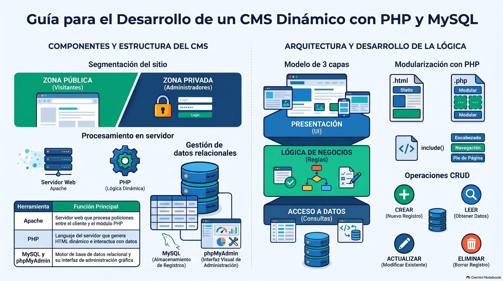

# Semana 6 — Desarrollando un CMS Dinámico
**Proyecto Integrado (GPD2201) · Experiencia 3**
**Clase sincrónica:** Martes 24 de noviembre de 2026 · 19:00 hrs

---



---

## Introducción

Iniciamos la **Experiencia 3: Programando nuestro sitio**. Hasta ahora tu sitio es **estático**: el contenido está escrito directo en el HTML. Esta semana lo conviertes en un sitio **dinámico**, en el que el contenido (productos, artículos, servicios…) se guarda en una **base de datos MySQL** y se muestra con **PHP**.

Para eso configuras tu **entorno local** (XAMPP o MAMP) y el **remoto** (el hosting de Duoc), diseñas tu base de datos y programas las primeras páginas dinámicas.

> 💡 **Preguntas activadoras:** ¿Qué tipo de sitio estás creando? ¿Qué datos necesita guardar la base de datos? ¿La administrarás a mano o con un CMS? ¿Qué necesitas en rendimiento y escalabilidad?

---

## Resultados de Aprendizaje e Indicadores de Logro

**RA1.** Define propuestas de un emprendimiento y/o servicio considerando las etapas y factores que inciden en la elaboración de un proyecto según los requerimientos del mercado, cliente y/o usuario.

**RA2.** Aplica técnicas de distribución de contenidos en pantalla considerando la jerarquía de información, a fin de conectar la arquitectura de la información con el diseño de interfaz.

**RA3.** Crea sitio web utilizando framework y preprocesadores para optimizar el desarrollo de sitios web responsivos.

**RA4.** Programa acciones para la interacción, definiendo base de datos, vía SQL, considerando framework de CSS, criterios de usabilidad y accesibilidad y criterios del proyecto.

| IL | Indicador |
|----|-----------|
| **IL1** | Define el proceso de desarrollo del emprendimiento o servicio en un brief, considerando acciones, tiempo y recursos. |
| **IL2** | Identifica los problemas y necesidades mediante el análisis de los factores que inciden el proyecto, a fin de generar una propuesta que responda a los requerimientos del cliente y usuario. |
| **IL4** | Arma mapa de navegación de sitio considerando los contenidos del proyecto. |
| **IL5** | Utiliza wireframes para la distribución jerárquica de los contenidos, considerando criterios de funcionalidad e interacción en coherencia con los objetivos del proyecto. |
| **IL6** | Arma diseño de interfaz interactiva, considerando la guía de estilos definida. |
| **IL7** | Construye archivos HTML considerando la nomenclatura y estructura de documento según estándar W3C. |
| **IL8** | Utiliza frameworks, variables nativas de CSS y preprocesadores, para optimizar el desarrollo de un sitio web. |
| **IL9** | Desarrolla un sitio web responsivo, considerando los requerimientos visuales y técnicos del proyecto. |
| **IL10** | Utiliza lenguajes de programación para la administración del sitio. |

---

## Conceptos Clave de la Semana

`Sitio administrable` · `PHP` · `MySQL` · `phpMyAdmin` · `Base de datos`

---

## Contenidos

### 1. Sitio administrable: zona pública y zona privada

Un **CMS** (sistema de gestión de contenidos) tiene dos áreas:

| Zona | Quién entra | Qué hay |
|------|-------------|---------|
| **Pública** | Cualquier visitante | Los contenidos del sitio: textos, fotos, videos… |
| **Privada** | Solo usuarios autorizados (con login) | Páginas para administrar contenidos, apariencia y usuarios |

Antes de programar, define **qué contenidos serán administrables** (productos, artículos, páginas…) y **qué funciones necesitas** (usuarios, categorías, etiquetas…). Esta semana trabajas la parte pública alimentada desde la base de datos; en la Semana 7 construyes la zona privada.

---

### 2. Lo que necesita un sitio dinámico

1. **Servidor web (Apache):** recibe la solicitud del navegador y ejecuta el PHP. Trabajarás en local y en remoto.
2. **Base de datos:** guarda la información en **tablas**; cada **columna** es un tipo de dato y cada **fila** es un registro.
3. **Lenguaje de programación:** **PHP** se ejecuta en el servidor y genera el HTML; **JavaScript** se ejecuta en el navegador y agrega interactividad.
4. **MySQL:** sistema de gestión de bases de datos relacional; usa **SQL** para insertar, consultar, actualizar y eliminar datos.
5. **phpMyAdmin:** interfaz web para administrar MySQL sin escribir todo el SQL a mano.

---

### 3. PHP básico

Tus páginas dinámicas ahora usan la extensión **`.php`** (`index.php`, `contacto.php`…).

| Elemento | Cómo se usa |
|----------|-------------|
| **Apertura y cierre** | `<?php … ?>`. Usa siempre esta forma: las formas cortas que menciona la guía pueden no funcionar en servidores actuales. |
| **Instrucciones** | Cada instrucción termina en **punto y coma** `;`. |
| **Variables** | Empiezan con `$`, distinguen mayúsculas (`$nombre` ≠ `$Nombre`), parten con letra y no llevan espacios. |
| **Funciones** | `function nombre($parametro) { … }`. PHP trae muchas funciones predefinidas. |
| **`include`** | Reutiliza archivos como `header.php` y `footer.php`. El fragmento incluido **no** lleva `<head>` ni `<body>`. |
| **Bloques `{ }`** | Marcan el inicio y fin de una función o estructura de control. |
| **Arreglos `[ ]`** | Guardan varios valores en una sola variable. |
| **Salida** | `echo` (acepta varios valores) y `print` (uno solo). |

```php
<?php
$titulo = "Plantas de interior";
echo "<h1>$titulo</h1>";
?>
```

---

### 4. Configurar el entorno

- **Local:** instala **XAMPP** (Windows) o **MAMP** (Mac); ambos traen Apache, MySQL y phpMyAdmin.
- **Orden importante:** primero enciende **Apache** (y MySQL); sin Apache corriendo, phpMyAdmin no carga.
- **Remoto:** al terminar, sube tus archivos **y tu base de datos** al servidor (hosting de Duoc).
- 🎥 Videos de apoyo en la guía: crear bases de datos y tablas en phpMyAdmin, y agregar, editar y borrar datos.

**Poblar** la base de datos es llenar con datos las tablas recién creadas.

---

### 5. Diseño de la base de datos

- **Separa los datos** en tablas según su tipo (por ejemplo: clientes, productos, ventas).
- **Relaciona las tablas** cuando corresponda (un cliente puede tener muchas compras).
- Usa **nombres de campos descriptivos** (`nombre`, `email`), no «campo1».
- Define bien el **tipo de dato** de cada columna y una **clave primaria** por tabla.
- **Nombres de tablas** sin tildes, sin ñ, sin espacios ni símbolos: solo letras, números y guion bajo.

---

### 6. Lógica de negocio: las 3 capas

| Capa | Responsabilidad |
|------|-----------------|
| **Presentación** | Lo que ve el usuario: la interfaz. |
| **Lógica de negocio** | Las reglas del negocio: cómo se procesan los datos y las acciones. |
| **Acceso a datos** | Leer, escribir, actualizar y eliminar en la base de datos. |

Tareas clave: escribir la lógica en PHP, implementar **autenticación** si hace falta, crear funciones para **conectar y consultar** la base de datos e implementar el **CRUD** (Crear, Leer, Actualizar, Eliminar) con consultas seguras.

---

### 7. Páginas dinámicas

PHP genera HTML según los datos. Como el navegador recibe solo el HTML resultante, **valida la salida** (lo que ves con «Ver código fuente») en el W3C Validator: un error de PHP puede romper el HTML y la visualización.

---

## Actividad Formativa 4 (AF4) — Comenzando la programación del sitio

> Convertirás tu sitio estático en **dinámico**: identificarás qué partes deben salir de la base de datos, diseñarás el esquema (tablas, campos y relaciones), configurarás tu entorno **local y remoto**, conectarás el sitio a la base de datos, implementarás funciones **CRUD** y la lógica para manejar los datos (validación, procesamiento de formularios). Prueba todo en local antes de subirlo.

**¿Qué revisa la pauta?** Brief, problemas y necesidades, mapa de navegación, wireframes, diseño de interfaz, HTML según W3C, frameworks/variables CSS/preprocesadores, sitio responsivo y **uso de lenguajes de programación para la administración del sitio**.

- 🔗 **Entrega:** sube tu sitio y tu base de datos al **hosting de Duoc**, copia la **URL** y pégala en el documento de la actividad
- 📅 Fecha límite: **Lunes 30 de noviembre de 2026 a las 23:59 hrs**
- 📤 Entrega exclusiva por la plataforma AVA

---

## Cierre de Semana

Un CMS tiene una zona pública, visible para todos, y una zona privada para quienes administran el contenido. Esta semana revisaste lo básico de PHP, la importancia de **Apache** y **MySQL**, y cómo diseñar una base de datos que refleje los contenidos de tu proyecto. Tus archivos ya son `.php`: tu sitio ahora lee su contenido desde la base de datos.

---

[📄 Ver Presentación de la Clase](material-clase/presentacion.pdf)
