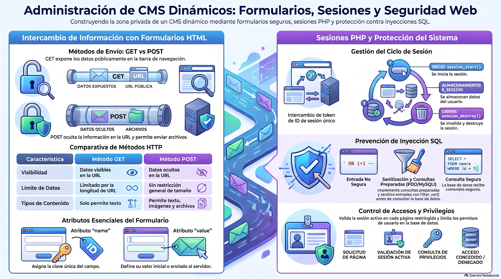

# Semana 7 — Administración de un CMS Dinámico
**Proyecto Integrado (GPD2201) · Experiencia 3**
**Clase sincrónica:** Martes 1 de diciembre de 2026 · 19:00 hrs

---



---

## Introducción

En la Semana 6 tu sitio empezó a leer su contenido desde la base de datos. Ahora construyes la **zona privada**: un **administrador de contenidos** para que tu cliente pueda agregar, editar y eliminar información **sin tocar el código**, y que esos cambios se vean en el sitio público.

Para eso necesitas **formularios** (GET y POST), **sesiones PHP** para el login y buenas prácticas de **seguridad**.

> 💡 **Preguntas activadoras:** ¿Cómo entrará tu cliente a su área privada? ¿Qué datos va a gestionar? ¿Qué recorrido hará dentro del administrador?

---

## Resultados de Aprendizaje e Indicadores de Logro

**RA1.** Define propuestas de un emprendimiento y/o servicio considerando las etapas y factores que inciden en la elaboración de un proyecto según los requerimientos del mercado, cliente y/o usuario.

**RA2.** Aplica técnicas de distribución de contenidos en pantalla considerando la jerarquía de información, a fin de conectar la arquitectura de la información con el diseño de interfaz.

**RA3.** Crea sitio web utilizando framework y preprocesadores para optimizar el desarrollo de sitios web responsivos.

**RA4.** Programa acciones para la interacción, definiendo base de datos, vía SQL considerando framework de CSS, criterios de usabilidad y accesibilidad y criterios del proyecto.

| IL | Indicador |
|----|-----------|
| **IL1** | Define el proceso de desarrollo del emprendimiento o servicio en un brief, considerando acciones, tiempo y recursos. |
| **IL2** | Identifica los problemas y necesidades mediante el análisis de los factores que inciden el proyecto, a fin de generar una propuesta que responda a los requerimientos del cliente y usuario. |
| **IL4** | Arma mapa de navegación de sitio considerando los contenidos del proyecto. |
| **IL5** | Utiliza wireframes para la distribución jerárquica de los contenidos, considerando criterios de funcionalidad e interacción en coherencia con los objetivos del proyecto. |
| **IL6** | Arma diseño de interfaz interactiva, considerando la guía de estilos definida. |
| **IL7** | Construye archivos HTML considerando la nomenclatura y estructura de documento según estándar W3C. |
| **IL8** | Utiliza frameworks, variables nativas de CSS y preprocesadores, para optimizar el desarrollo de un sitio web. |
| **IL9** | Desarrolla un sitio web responsivo, considerando los requerimientos visuales y técnicos del proyecto. |
| **IL10** | Utiliza lenguajes de programación para la administración del sitio. |
| **IL11** | Utiliza lenguajes de programación para definir y controlar las interacciones y comportamientos de un sitio web. |

---

## Conceptos Clave de la Semana

`Sitio privado` · `Interfaz del panel` · `Formularios HTML` · `Método GET` · `Método POST` · `Atributo name` · `Atributo value` · `Sesiones en PHP` · `Seguridad`

---

## Contenidos

### 1. El administrador de contenidos

Para construir la zona privada necesitas:

- **Navegación del administrador**, con un ítem por cada tipo de contenido (por ejemplo: usuarios, noticias, productos).
- **Una página por ítem** de administración.
- **Una página de login** donde los usuarios autorizados ingresan con usuario y contraseña.

El panel no lo ven los visitantes, pero debe ser **funcional e intuitivo**: simple, sin exceso de color ni efectos, para que la persona haga sus tareas rápido. 📚 Inspiración: [AdminLTE](https://adminlte.io/).

---

### 2. Piensa en casos de uso

Ponte en el lugar de quien administra. Por ejemplo, para **agregar una noticia**: entra con su login → elige «Agregar noticia» → completa título, contenido, fecha y categoría → adjunta una imagen si hace falta → guarda.

Ese caso de uso te dice qué páginas crear:

1. Página de **login**
2. **Home** del administrador
3. Menú del ítem (por ejemplo, Noticias → Agregar)
4. Página de **agregar** con los campos requeridos
5. **Listado** con las opciones **editar** y **eliminar**

---

### 3. Formularios: GET y POST

Los formularios `<form>` envían información de una página a otra; por sí solos no hacen nada, hasta que PHP procesa los datos.

| | **POST** | **GET** |
|---|----------|---------|
| ¿Se ven los datos en la URL? | No | Sí (query string `?id=3`) |
| ¿Quedan en el historial? | No | Sí |
| Tamaño | Sin un límite específico (el servidor puede fijar uno) | Limitado por el largo de la URL |
| Tipo de datos | Texto, imágenes y archivos | Solo texto |
| Úsalo para | Crear, editar, login | Filtrar, buscar, indicar qué registro ver |

Cada campo del formulario necesita:

- **`name`:** nombre **único**; es la clave con la que llega el dato al servidor.
- **`value`:** valor inicial o predeterminado (por ejemplo, el dato actual en un formulario de edición).

```html
<form action="guardar.php" method="post">
  <label for="titulo">Título</label>
  <input type="text" id="titulo" name="titulo" value="">
  <button type="submit">Guardar</button>
</form>
```

---

### 4. Sesiones en PHP

Una **sesión** guarda datos temporales del usuario en el servidor mientras navega, asociados a un **ID de sesión**. Sirven para mantener a alguien **autenticado** después del login, guardar preferencias o un carrito, y verificar que una solicitud viene de un usuario válido.

| Paso | Código |
|------|--------|
| 1. Iniciar la sesión (al inicio de cada página que la use) | `session_start();` |
| 2. Guardar un valor | `$_SESSION['usuario'] = $nombre;` |
| 3. Leer el valor en otra página | `$_SESSION['usuario']` |
| 4. Cerrar la sesión | `session_destroy();` |

**Cada página privada** debe iniciar y **verificar** la sesión; si no hay usuario autenticado, redirige al login.

---

### 5. Seguridad: evitar la inyección SQL

Una **inyección SQL** es un ataque que mete instrucciones SQL no deseadas a través de un formulario o de la URL. Para prevenirla:

- Usa **consultas preparadas** (PDO o MySQLi) en vez de concatenar lo que escribe el usuario dentro del SQL.
- **Valida y sanitiza** los datos de entrada. La guía menciona `FILTER_SANITIZE_STRING`, que está obsoleto desde PHP 8.1: valida con `filter_var()` y escapa al mostrar con `htmlspecialchars()`.
- Da a la cuenta de la base de datos **solo los privilegios necesarios**.
- **No muestres errores detallados** al usuario; regístralos en archivos de log.
- Mantén **PHP, MySQL y las librerías actualizados**.

---

## Actividad Formativa 5 (AF5) — Programando las páginas de administración de un sitio

> Programarás la **zona privada** de tu sitio: definirás qué ítems se administran y qué acciones hará el usuario (agregar, editar, borrar); crearás la home del administrador, los formularios para agregar y editar y las páginas para ver y gestionar el contenido; implementarás formularios con **POST o GET** (cada campo con `name` único y `value` cuando corresponda) y **sesiones PHP**, protegiendo el sitio de la inyección SQL y de datos mal validados.
>
> Antes de entregar, comprueba que los cambios del administrador se vean en el sitio público y que las páginas privadas estén protegidas con login.

**¿Qué revisa la pauta?** Brief, problemas y necesidades, mapa de navegación, wireframes, diseño de interfaz, HTML según W3C, frameworks/variables CSS/preprocesadores, sitio responsivo, **programación para la administración del sitio** y **programación de interacciones**.

- 🔗 **Entrega:** sube tu sitio y tu base de datos al **hosting de Duoc**, copia la **URL** y pégala en el documento de la actividad
- 📅 Fecha límite: **Lunes 7 de diciembre de 2026 a las 23:59 hrs**
- 📤 Entrega exclusiva por la plataforma AVA

---

## Cierre de Semana

El panel de administración le da a tu cliente **independencia** para manejar su sitio. Debe ser intuitivo, pensado desde los casos de uso y las operaciones **CRUD**. Como es un área sensible, usa **sesiones** para autenticar a los usuarios y aplica medidas de seguridad contra la inyección SQL.

---

[📄 Ver Presentación de la Clase](material-clase/presentacion.pdf)
