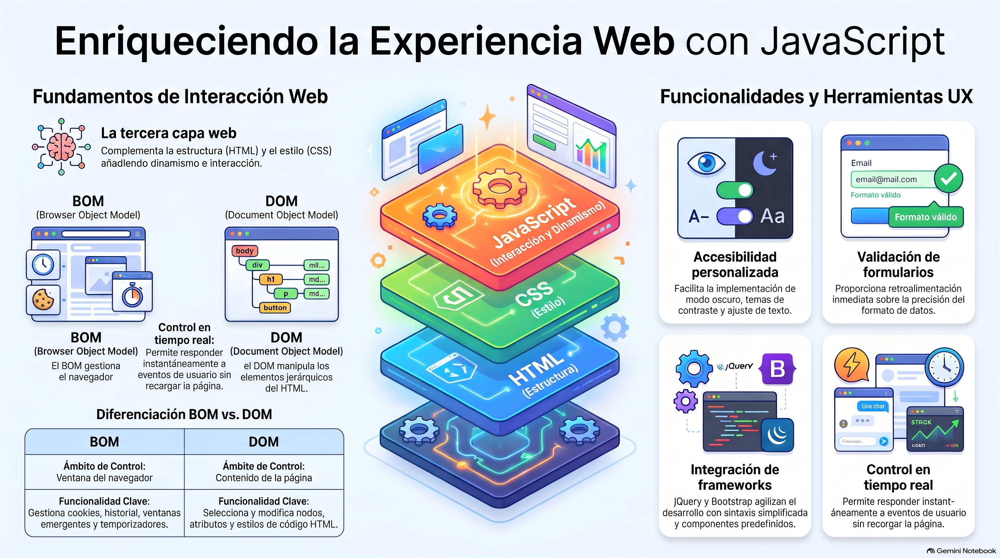

# Semana 8 — Mejorando Interacciones en el CMS
**Proyecto Integrado (GPD2201) · Experiencia 3**
**Clase sincrónica:** Martes 8 de diciembre de 2026 · 19:00 hrs

---



---

## Introducción

Tu sitio ya tiene zona pública y zona privada. Esta semana cierras la construcción con **JavaScript**: la tercera capa de la web, después de HTML (estructura) y CSS (estilo). Con JavaScript validas formularios, muestras u ocultas elementos, cargas contenido sin recargar la página y respondes a lo que hace el usuario.

Es la **Actividad Sumativa 3**, la última antes de la Evaluación Final Transversal.

> 💡 **Preguntas activadoras:** ¿Cómo mejoro con interacciones la experiencia en el administrador de contenidos? ¿Cómo obtengo información de la pantalla y del dispositivo para personalizar la experiencia? ¿Cómo mejoro la accesibilidad de mi sitio?

---

## Resultados de Aprendizaje e Indicadores de Logro

**RA1.** Define propuestas de un emprendimiento y/o servicio considerando las etapas y factores que inciden en la elaboración de un proyecto según los requerimientos del mercado, cliente y/o usuario.

**RA2.** Aplica técnicas de distribución de contenidos en pantalla considerando la jerarquía de información, a fin de conectar la arquitectura de la información con el diseño de interfaz.

**RA3.** Crea sitio web utilizando framework y preprocesadores para optimizar el desarrollo de sitios web responsivos.

**RA4.** Programa acciones para la interacción, definiendo base de datos, vía SQL considerando framework de CSS, criterios de usabilidad y accesibilidad y criterios del proyecto.

| IL | Indicador |
|----|-----------|
| **IL1** | Define el proceso de desarrollo del emprendimiento o servicio en un brief, considerando acciones, tiempo y recursos. |
| **IL2** | Identifica los problemas y necesidades mediante el análisis de los factores que inciden el proyecto, a fin de generar una propuesta que responda a los requerimientos del cliente y usuario. |
| **IL4** | Arma mapa de navegación de sitio considerando los contenidos del proyecto. |
| **IL5** | Utiliza wireframes para la distribución jerárquica de los contenidos, considerando criterios de funcionalidad e interacción en coherencia con los objetivos del proyecto. |
| **IL6** | Arma diseño de interfaz interactiva, considerando la guía de estilos definida. |
| **IL7** | Construye archivos HTML considerando la nomenclatura y estructura de documento según estándar W3C. |
| **IL8** | Utiliza frameworks, variables nativas de CSS y preprocesadores, para optimizar el desarrollo de un sitio web. |
| **IL9** | Desarrolla un sitio web responsivo, considerando los requerimientos visuales y técnicos del proyecto. |
| **IL10** | Utiliza lenguajes de programación para la administración del sitio. |
| **IL11** | Utiliza lenguajes de programación para definir y controlar las interacciones y comportamientos de un sitio web. |

---

## Conceptos Clave de la Semana

`JavaScript` · `BOM` · `DOM` · `jQuery` · `Interacción`

---

## Contenidos

### 1. BOM y DOM

| | **BOM** (Browser Object Model) | **DOM** (Document Object Model) |
|---|------------|------------|
| Representa | El **navegador**: ventana, historial, barra de direcciones | El **contenido de la página**: elementos, atributos y texto como un árbol de nodos |
| Se usa para | Ventanas emergentes, confirmaciones, cookies, redirecciones, temporizadores | Leer y cambiar elementos, su contenido, estilos y eventos |
| Relación | Contiene al DOM (dentro de `window`) | Es parte del BOM |

```js
// DOM: seleccionar un elemento y cambiar su texto
const titulo = document.querySelector('#titulo');
titulo.textContent = '¡Bienvenida/o!';

// BOM: confirmar antes de salir de la página
if (confirm('¿Quieres volver al inicio?')) {
  window.location.href = 'index.php';
}
```

---

### 2. Qué puedes hacer con JavaScript en tu sitio

- **Modo oscuro y alto contraste:** un botón que alterna un conjunto de estilos CSS. Agrega transiciones suaves, da una señal visual de que cambió el modo y comprueba que el contraste se mantenga en ambos modos.
- **Agrandar o achicar el texto** con botones que modifican las propiedades CSS.
- **Ayudas contextuales** al pasar el mouse sobre un elemento.
- **Validación de formularios en tiempo real**, mientras la persona escribe.

Juntas, estas opciones forman un **menú de accesibilidad** para que cada usuario adapte la interfaz.

---

### 3. JavaScript en el panel de administración

| Uso | Ejemplo |
|-----|---------|
| **Validar formularios** | Revisar que los campos obligatorios estén completos y que el correo tenga formato válido antes de enviar. |
| **Notificaciones** | Confirmar una acción o avisar un error (`alert()` o, mejor, una alerta o toast de Bootstrap). |
| **Actualizar sin recargar** | Mostrar cambios en la interfaz sin recargar toda la página. |
| **Ordenar y filtrar** | Ordenar una tabla por nombre o fecha, o filtrar por estado. |
| **Validación en el cliente** | Comprobar que dos contraseñas coincidan y cumplan los requisitos antes de enviarlas. |
| **Recordar preferencias** | Guardar en `localStorage` si el usuario prefiere el tema oscuro. |

> ⚠️ La validación en el navegador mejora la experiencia, pero **no reemplaza** la validación en PHP: el servidor siempre debe volver a validar.

---

### 4. jQuery

**jQuery** no es otro lenguaje: es una **biblioteca de JavaScript** que simplifica la sintaxis para manipular el DOM y manejar eventos.

```js
// Seleccionar elementos: igual que un selector CSS
$('.tarjeta');   $('#menu');

// Escuchar eventos con on()
$('#btnTema').on('click', function () {
  $('body').toggleClass('tema-oscuro');
});
```

Para usarla, incluye la biblioteca en tu proyecto (descargada o por **CDN**) **antes** de tu propio archivo JS.

---

### 5. JavaScript de Bootstrap

Bootstrap trae componentes con el JavaScript ya programado. Solo debes **incluir su archivo JS** (por ejemplo `bootstrap.bundle.min.js`) y adaptarlos a tu proyecto:

[Validación de formularios](https://getbootstrap.com/docs/5.3/forms/validation/) · [Accordion](https://getbootstrap.com/docs/5.3/components/accordion/) · [Alerts](https://getbootstrap.com/docs/5.3/components/alerts/) · [Carousel](https://getbootstrap.com/docs/5.3/components/carousel/) · [Collapse](https://getbootstrap.com/docs/5.3/components/collapse/) · [Dropdowns](https://getbootstrap.com/docs/5.3/components/dropdowns/) · [Modal](https://getbootstrap.com/docs/5.3/components/modal/) · [Popovers](https://getbootstrap.com/docs/5.3/components/popovers/) · [Scrollspy](https://getbootstrap.com/docs/5.3/components/scrollspy/) · [Toasts](https://getbootstrap.com/docs/5.3/components/toasts/) · [Tooltips](https://getbootstrap.com/docs/5.3/components/tooltips/)

📚 [Cómo trabaja Bootstrap con JavaScript](https://getbootstrap.com/docs/5.3/getting-started/javascript/)

---

## Actividad Sumativa 3 (AS3) — Agregando interacciones al proyecto

> Usarás **JavaScript** (y jQuery si lo necesitas) para agregar interacciones a tu sitio: **validar formularios** (campos completos, formato de correo), **mostrar u ocultar** elementos (menús, mensajes de error), **actualizar partes del sitio sin recargar**, responder a **eventos** (clics, desplazamiento) y **manipular el DOM** (contenido y estilos en tiempo real). Prueba todo en distintos navegadores y dispositivos.

**¿Qué evalúa la rúbrica?** Diez criterios: **brief**, **problemas y necesidades**, **mapa de navegación**, **wireframes**, **diseño de interfaz**, **HTML según W3C**, **frameworks, variables CSS y preprocesadores**, **sitio responsivo**, **programación para la administración del sitio** y **programación de interacciones y comportamientos**. Es la revisión de todo tu proyecto, no solo del JavaScript.

- 🔗 **Entrega:** sube tu sitio y tu base de datos al **hosting de Duoc**, copia la **URL** y pégala en el documento de la actividad
- 📝 Si hiciste mejoras durante el proceso, documéntalas en un **informe** y entrégalo junto con la actividad
- 📅 Fecha límite: **Lunes 14 de diciembre de 2026 a las 23:59 hrs**
- 📤 Entrega exclusiva por la plataforma AVA

---

## Cierre de Semana

Con JavaScript mejoraste la **accesibilidad** (modo oscuro, tamaño de texto) y le diste **retroalimentación** al usuario sobre lo que hace, algo clave en el panel de administración, donde se modifican datos. Muchas interacciones ya vienen resueltas en Bootstrap: solo hay que saber aplicarlas. Antes de entregar, prueba interacciones, servidor y compatibilidad en distintos navegadores y dispositivos.

---

[📄 Ver Presentación de la Clase](material-clase/presentacion.pdf)
