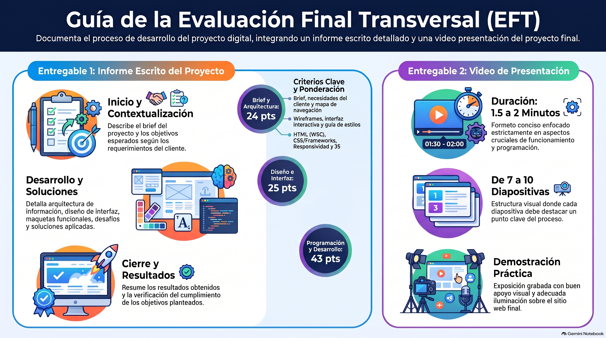

# Semana 9 — Evaluación Final Transversal (EFT)
**Proyecto Integrado (GPD2201) · EFT**
**Clase sincrónica:** Martes 15 de diciembre de 2026 · 19:00 hrs

---

---

## Introducción

Llegamos al cierre del ramo. La **Evaluación Final Transversal** te pide **documentar y presentar todo el proceso** de tu proyecto digital a lo largo de las tres experiencias: desde el brief hasta el sitio programado, incluyendo los **cambios**, los **desafíos** y las **soluciones** que encontraste en el camino.

Entregas dos cosas: un **informe escrito** y un **video** corto que dé cuenta de ese proceso.

> 💡 **Preguntas para empezar:** ¿Qué esperaba lograr mi proyecto al inicio? ¿Qué cambió en el camino y por qué? ¿Qué problemas tuve y cómo los resolví? ¿Logré los objetivos del brief?

---

## Resultados de Aprendizaje e Indicadores de Logro

La EFT integra **todos** los resultados de aprendizaje del ramo (RA1 a RA4).

| IL | Indicador |
|----|-----------|
| **IL1** | Define el proceso de desarrollo del emprendimiento o servicio en un brief, considerando acciones, tiempo y recursos. |
| **IL2** | Identifica los problemas y necesidades mediante el análisis de los factores que inciden el proyecto, a fin de generar una propuesta que responda a los requerimientos del cliente y usuario. |
| **IL3** | Identifica los distintos tipos de licencia para la utilización de recursos en el proyecto digital, a fin de garantizar la viabilidad legal, técnica y comercial del proyecto. |
| **IL4** | Arma mapa de navegación de sitio considerando los contenidos del proyecto. |
| **IL5** | Utiliza wireframes para la distribución jerárquica de los contenidos, considerando criterios de funcionalidad e interacción en coherencia con los objetivos del proyecto. |
| **IL6** | Arma diseño de interfaz interactiva, considerando la guía de estilos definida. |
| **IL7** | Construye archivos HTML considerando la nomenclatura y estructura de documento según estándar W3C. |
| **IL8** | Utiliza frameworks, variables nativas de CSS y preprocesadores, para optimizar el desarrollo de un sitio web. |
| **IL9** | Desarrolla un sitio web responsivo, considerando los requerimientos visuales y técnicos del proyecto. |
| **IL10** | Utiliza lenguajes de programación para la administración del sitio. |
| **IL11** | Utiliza lenguajes de programación para definir y controlar las interacciones y comportamientos de un sitio web. |

---

## Conceptos Clave de la Semana

`Brief` · `Arquitectura de información` · `Diseño de interfaz` · `Maquetas funcionales` · `Programación` · `Documentación del proceso` · `Presentación`

---

## Contenidos

### 1. Qué debe evidenciar tu EFT

Tanto el informe como el video muestran el proceso completo del proyecto:

| Etapa | Qué mostrar | Semana |
|-------|-------------|:------:|
| **Brief** | La descripción inicial del proyecto entregada por el cliente, objetivos, presupuesto y licencias | 1 |
| **Arquitectura de información** | Cómo organizaste y estructuraste los contenidos: inventario, mapa de navegación y wireframes | 2 |
| **Diseño de interfaz** | Cómo se ve tu sitio: guía de estilos y diseño de alta | 3 |
| **Maquetas funcionales** | El sitio en HTML, CSS y Bootstrap, responsivo | 4 y 5 |
| **Programación final** | Sitio dinámico con PHP y MySQL, administrador de contenidos e interacciones con JavaScript | 6, 7 y 8 |

---

### 2. Estructura del informe

| Sección | Qué incluye |
|---------|-------------|
| **Inicio** | El **brief** del proyecto y los **objetivos** que se esperaban lograr. |
| **Desarrollo** | El proceso: **arquitectura de la información**, **diseño de interfaz** y **maquetas funcionales**. Describe los **desafíos** que encontraste y las **soluciones** que aplicaste. |
| **Cierre** | Los **resultados** obtenidos y **cómo se lograron** los objetivos del proyecto. |

---

### 3. El video de presentación

- **Duración:** entre **1,5 y 2 minutos**, nunca más de 2.
- **Diapositivas:** mínimo **7** y máximo **10**; cada una destaca **un punto clave** del proceso.
- **Coherente con el informe**, pero con foco en lo más importante: **el funcionamiento del sitio y su programación**.
- Usa **apoyo visual** que refuerce tu mensaje.
- Graba en un lugar con **buena iluminación**.

---

### 4. ¿Cómo se evalúa?

La rúbrica tiene **12 criterios** que suman **100 puntos**. Los criterios 1 al 11 vuelven a revisar cada indicador del ramo (IL1 a IL11) en tu proyecto terminado. El criterio 12 evalúa la **presentación del proceso** de desarrollo: brief inicial, arquitectura de información, diseño de interfaz, maquetas funcionales y programación final.

> 📌 Que el sitio funcione **y** que sepas explicar cómo llegaste a él tienen el mismo peso: revisa que cada etapa esté actualizada y bien documentada.

---

## Evaluación Final Transversal (EFT)

> Elaborarás un **informe** (Inicio, Desarrollo y Cierre) y grabarás un **video de 1,5 a 2 minutos**, con **7 a 10 diapositivas**, que documenten el proceso completo de tu proyecto digital: brief, arquitectura de la información, diseño de interfaz, maquetas funcionales y sitio web con su programación final.

- 📄 Informe escrito + 🎥 video de presentación
- 📅 Fecha límite: **Lunes 21 de diciembre de 2026 a las 23:59 hrs**
- 📤 Entrega exclusiva por la plataforma AVA

---

## Cierre de Semana

En nueve semanas recorriste todo el ciclo de un proyecto digital con Diseño Centrado en el Usuario: **investigar y planificar**, **organizar la información**, **diseñar la interfaz**, **maquetar**, **programar** y **mejorar la experiencia**. La EFT es tu oportunidad de mostrar ese recorrido completo y lo que aprendiste en él.

---

[📄 Ver Presentación de la Clase](material-clase/presentacion.pdf)
